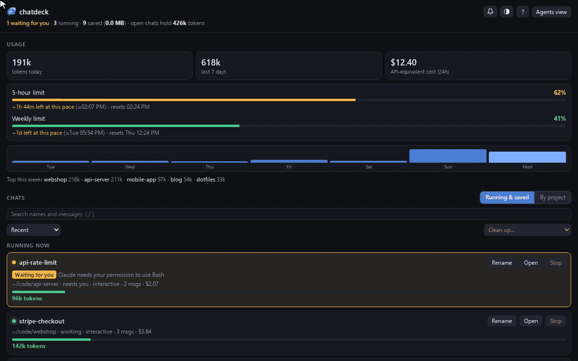
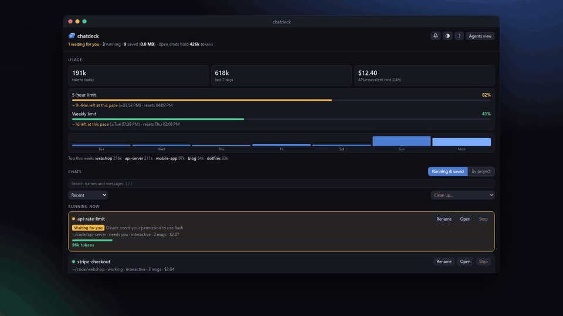
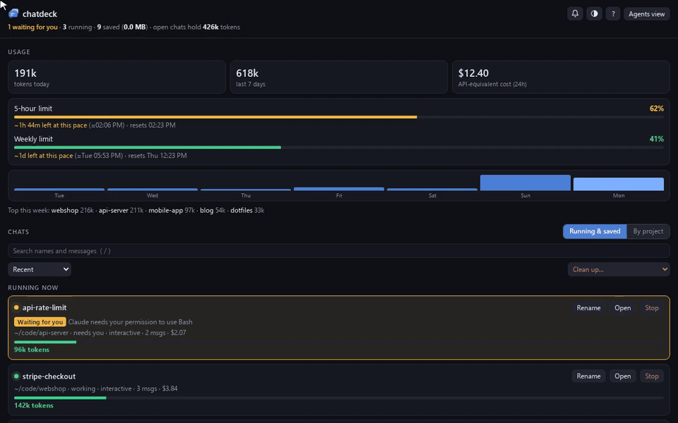
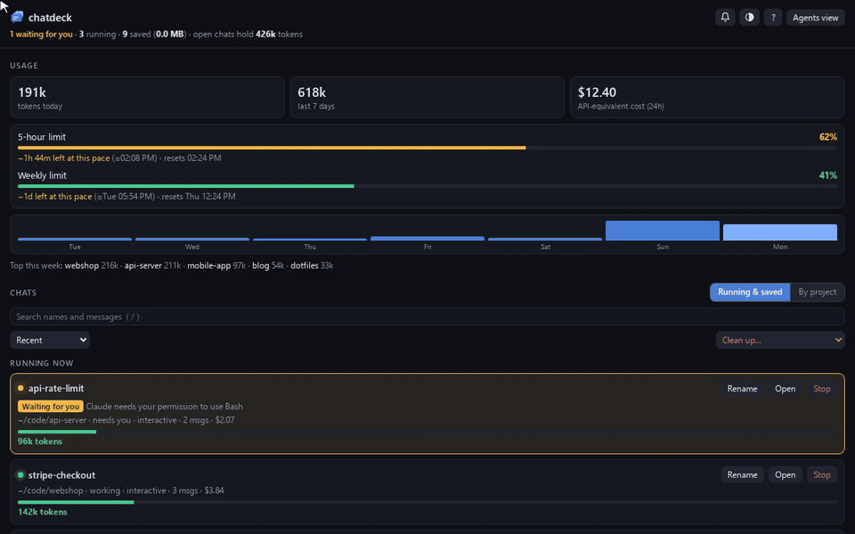
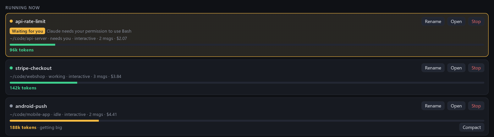
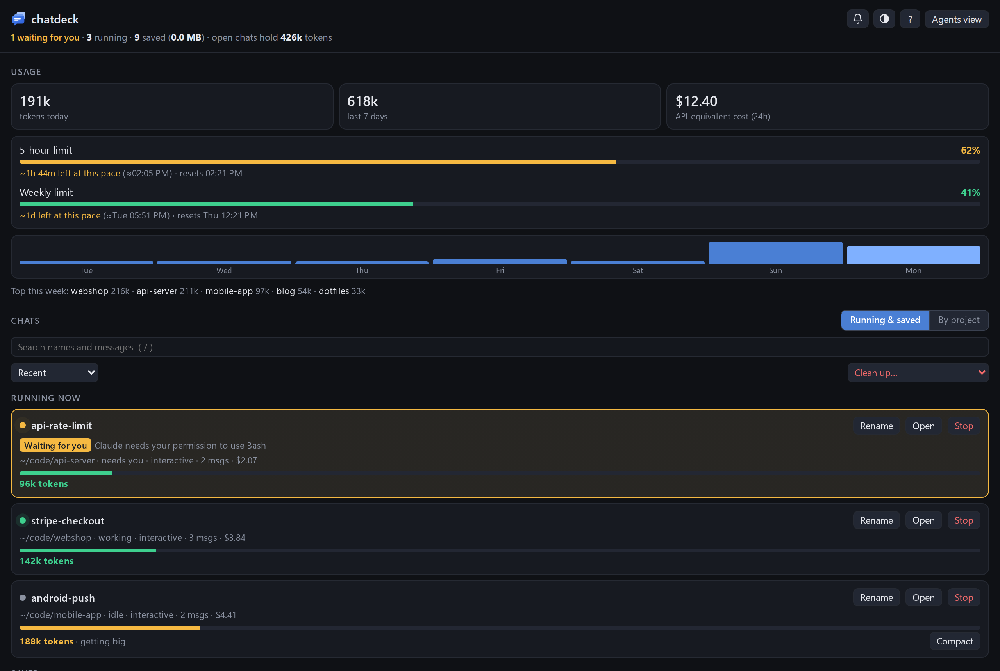
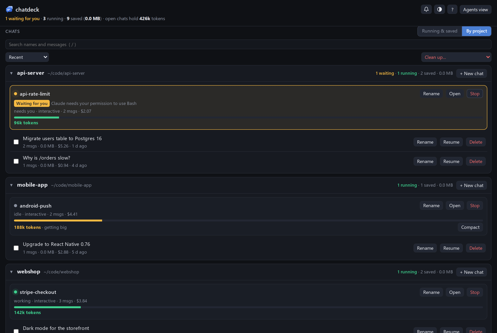
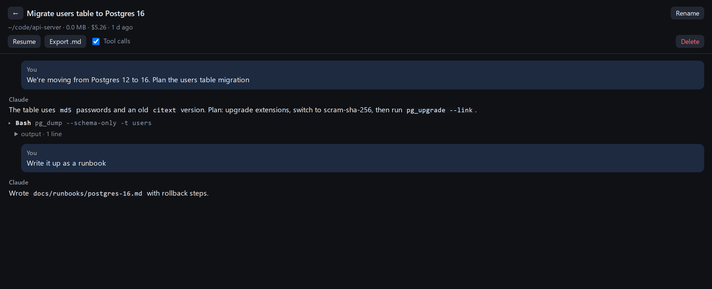
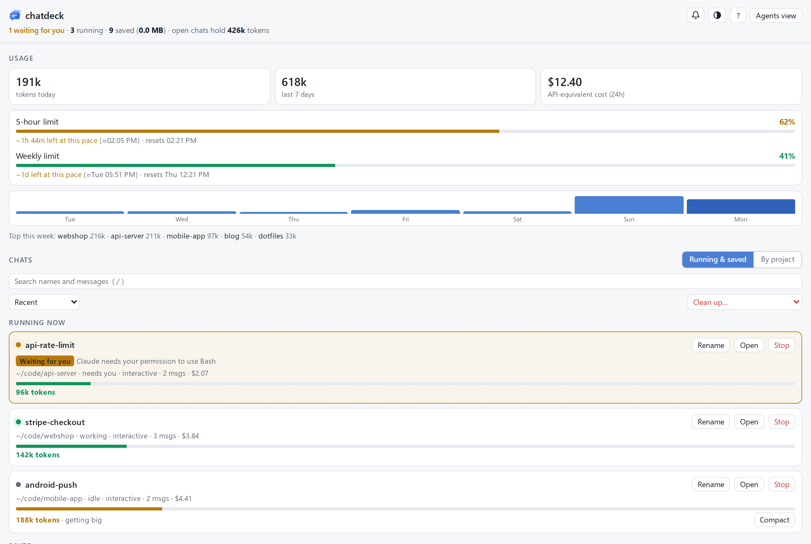
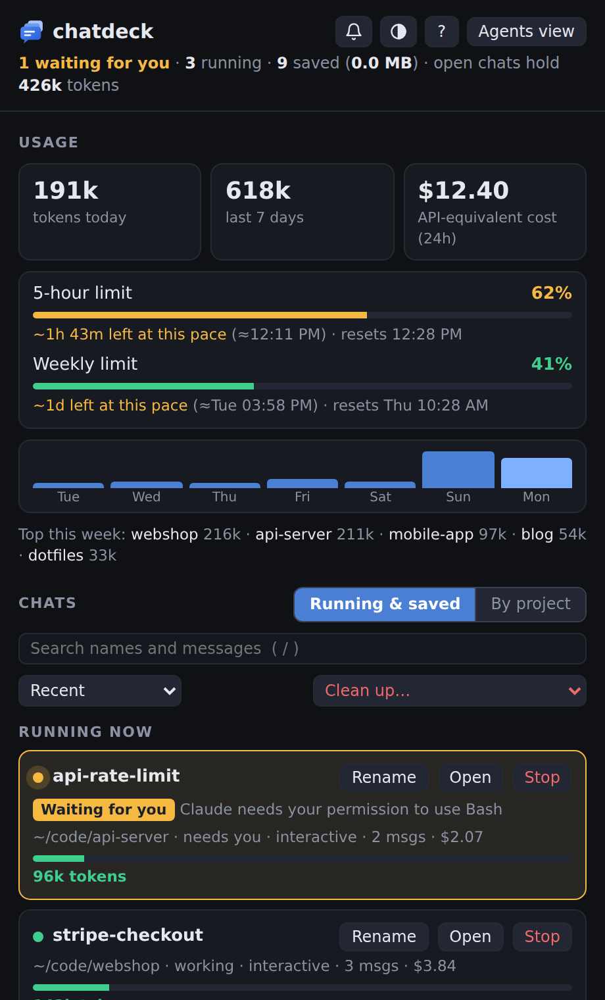

# chatdeck

A local dashboard for your Claude Code chats: see which chats are running and which need you,
read and search old chats, track usage against your plan limits, and clean up transcripts.
Python 3.9+ standard library only, no dependencies.



## Features

- **Running now** – every live session with its context size and cost. Sessions stuck on a
  permission prompt or a question get an amber **Waiting for you** badge and an optional chime.
  **Open** jumps to the chat's terminal tab, **Rename** runs `/rename` in it so Claude names it after what it's about (double-click the name to type your own), and big chats get a
  **Compact** button that runs `/compact`.
- **Saved chats** – read any chat without resuming it, search across all messages,
  rename (so you know what's in it), export to Markdown, resume in a terminal, delete.
- **Usage** – tokens today and this week, top projects, 24h cost, and your 5-hour and weekly
  limits with a forecast of when you'd hit them at the current pace.
- **Cleanup** – delete empty chats or chats older than 7, 30 or 90 days. Shows disk usage.
  Running chats are never deleted.
- **By project** view: one section per project (git repo, including its worktrees and subfolders)
  with its running and saved chats, and a **New chat** button that starts Claude Code in that project. Sort by recent, size, cost or messages. Light and dark themes.
  Keyboard shortcuts: `/` search, `j`/`k` move, `Enter` read, `r` resume, `e` rename, `x` select, `Del` delete, `?` help.
- **Windows corner button and tray icon** – pop the dashboard up from the corner of the screen.

## Install

```sh
pipx install chatdeck          # once it's on PyPI; until then:
pipx install git+https://github.com/Abdifatah09/chatdeck
```

No pip? Clone the repo and run `./install.sh`. It puts a `chatdeck` command in `~/.local/bin`
that runs straight from the clone.

## Try it first

```sh
chatdeck demo
```

opens chatdeck on a set of made-up chats (in a temporary folder, deleted when you stop it with Ctrl+C),
so you can click around without touching your own. The screenshots here are from the demo.

## Use

```sh
chatdeck                  # start the dashboard and open it
chatdeck setup            # add the Claude Code hooks for plan limits and "waiting for you"
chatdeck autostart on     # start it at login (Windows via WSL, macOS, Linux)
chatdeck bubble           # Windows: the corner button and tray icon
chatdeck demo             # try it with made-up chats
chatdeck stop             # stop the background server
chatdeck uninstall        # take the hooks and autostart out again
```

`chatdeck setup` keeps your existing status line: it saves the usage data first, then runs
yours, so your status line looks the same. `chatdeck uninstall` puts it back, and your previous
settings are backed up in `~/.chatdeck/backups`.

## Privacy and security

- Everything stays on your machine. chatdeck reads the transcripts Claude Code already writes to
  `~/.claude/projects` and sends nothing anywhere: no accounts, no telemetry, no network calls
  except to itself.
- The server binds to 127.0.0.1 only. Every API call needs a token that changes each run, sent in a
  custom header, so other websites open in your browser can't call it.
- It only changes things you ask it to: deleting a chat removes its transcript (running chats are
  never deleted), renaming adds a title line to it, and Rename and Compact on a running chat type
  `/rename` or `/compact` into that chat's terminal, only while it's idle.
- `chatdeck setup` edits `~/.claude/settings.json` and backs it up first; `chatdeck uninstall` undoes it.

## See it in action

| Find any chat by what was said in it | Every project in one place |
|---|---|
|  |  |

| Keyboard only: `j`/`k`, `Enter`, `e` to rename, `?` for help | Running chats, at a glance |
|---|---|
|  |  |

## Screenshots



| By project | Reading a chat |
|---|---|
|  |  |

| Light theme | The Windows pop-up |
|---|---|
|  |  |

## Windows corner button and tray icon

A small always-on-top button sits in the bottom-left corner of the screen. Click it and the
dashboard pops up above it; click again, or anywhere else, and it tucks away. The badge counts
running chats and turns amber, with a pulsing ring, when one is waiting for you. Drag it to move
it; right-click to hide it or for more. The same badge sits in the notification area by the
clock, where a click pops the dashboard up in the bottom-right corner. It needs Chrome or Edge.
Start it with `chatdeck bubble`, or let `chatdeck autostart on` start it at login.

## Terminals

**Resume**, **Open** and **Agents view** open or find a terminal for you:

| Platform | Opens chats in | Open on a running chat |
|---|---|---|
| WSL | Windows Terminal (new tab) | finds its tab on any virtual desktop and switches to it |
| macOS | Terminal, or iTerm2 if you run the dashboard from it | finds its tab by tty |
| Linux | gnome-terminal, konsole, kitty, alacritty, wezterm, xfce4-terminal, tilix, foot or xterm | finds its window with `wmctrl` or `xdotool` (X11) |

When no terminal can be opened, the dashboard copies the command to paste instead.
Finding a running chat works by briefly giving its tab a unique title, so it doesn't work for
tabs whose title is locked (Windows Terminal's `suppressApplicationTitle`).

## Settings

Settings live in `~/.chatdeck/config.json`, and environment variables override them:

- `port` / `CHATDECK_PORT`: default 47123
- `terminal` / `CHATDECK_TERMINAL`: which terminal to use, e.g. `kitty` or `iterm`
- `vdlib` / `CHATDECK_VDLIB` (WSL): Windows path to [VirtualDesktopLib.cs](https://github.com/MScholtes/VirtualDesktop),
  which makes switching to a chat on another virtual desktop reliable
- `CHATDECK_DIR`: where chatdeck keeps its data, default `~/.chatdeck`

## Tests

```sh
python3 -m unittest discover -s tests
```

## Screenshots and videos

Everything in `docs/` is recorded from `chatdeck demo` by a script, so it can be redone after UI changes
(needs Node; uses Segoe UI from `/mnt/c/Windows/Fonts` when run under WSL):

```sh
cd scripts/promo && npm install && npx playwright-core install chromium-headless-shell
npm run record                    # or just some: npm run record -- shots tour search projects keyboard
```

It writes the README screenshots to `docs/` and the GIFs, MP4s, framed screenshots and a 1280×640
social preview card to `docs/media/`.
